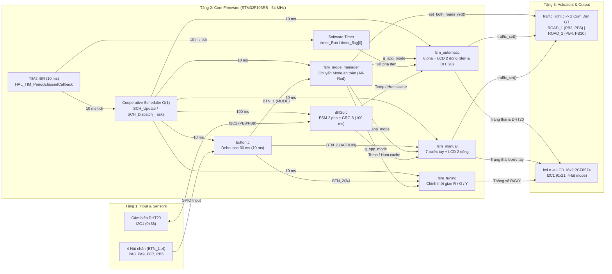

# Hệ thống Điều khiển Đèn Giao Thông & Giám sát Môi trường Thời gian thực trên STM32 (CO3009)

-03234B?style=flat-square&logo=stmicroelectronics&logoColor=white)
%20%7C%20FSM-1F6FEB?style=flat-square)


Hệ thống điều khiển đèn giao thông 2 tuyến (`ROAD_1`, `ROAD_2`) trên `STM32F103RB` (`64 MHz`), vận hành theo **Cooperative Scheduler** $O(1)$ với tick `10 ms` từ `TIM2`. Tầng ứng dụng dùng **FSM** 3 chế độ (`AUTO`, `MANUAL`, `TUNING`), nhận lệnh từ 4 nút nhấn `GPIO_PULLUP` chống dội `30 ms` (`BTN_1..4`). Bus `I2C1` (`PB8`/`PB9`) giao tiếp chung với cảm biến `DHT20` (`0x38`) non-blocking và màn hình `LCD 16x2` (`0x21`).

---

## 1. Kiến trúc hệ thống



---

## 2. Cấu trúc thư mục

```text
CO3009_2413713_2413648_2413763/
├── BTL.pdsprj                                  # File sơ đồ mạch mô phỏng Proteus 8
├── README.md                                   # Tài liệu kỹ thuật tổng quan dự án
├── README_FSM_INTEGRATION.md                   # Ghi chú tích hợp Scheduler + Driver + FSM
├── FSM Automatic.png                           # Lưu đồ máy trạng thái chế độ AUTO
├── FSM Manual.png                              # Lưu đồ máy trạng thái chế độ MANUAL
├── FSM Tuning.png                              # Lưu đồ máy trạng thái chế độ TUNING
├── fsm_mode_manager.png                        # Lưu đồ điều phối chuyển đổi chế độ
├── CO3009_2413713_2413648_2413763_Report.docx  # Báo cáo Bài tập lớn môn CO3009
├── PhanCong_BTL_CO3009.docx                    # Bảng phân công công việc nhóm
├── ThongBao_BTL_CO3009.pdf                     # Đề bài & yêu cầu kỹ thuật môn học
└── src/                                        # Project STM32CubeIDE
    ├── BTL_CO3009.ioc                          # File cấu hình chân & xung nhịp STM32CubeMX
    ├── STM32F103RBTX_FLASH.ld                  # Linker script bộ nhớ Flash/RAM STM32F103RB
    ├── Core/
    │   ├── Inc/
    │   │   ├── main.h                          # Định nghĩa chân GPIO (TL1/2, BTN_1..4) & HAL
    │   │   ├── scheduler.h                     # API Cooperative Scheduler O(1) (TICK_MS = 10)
    │   │   ├── software_timer.h                # API 5 kênh Software Timer (FSM_PHASE_TIMER)
    │   │   ├── global.h                        # Biến toàn cục g_app_mode & thời gian R/G/Y
    │   │   ├── traffic_light.h                 # API điều khiển đèn 2 tuyến (ROAD_1, ROAD_2)
    │   │   ├── button.h                        # API đọc 4 nút nhấn (Pressed/LongPressed/Held)
    │   │   ├── dht20.h                         # API cảm biến DHT20 (0x38) & quét bus I2C1
    │   │   ├── lcd.h                           # API màn hình LCD 16x2 I2C PCF8574 (0x21)
    │   │   ├── fsm_config.h                    # Ánh xạ nút nhấn & ngưỡng ràng buộc thời gian
    │   │   ├── fsm_mode_manager.h              # API điều phối 3 chế độ hoạt động
    │   │   ├── fsm_automatic.h                 # API máy trạng thái chế độ tự động
    │   │   ├── fsm_manual.h                    # API máy trạng thái chế độ bằng tay
    │   │   ├── fsm_tuning.h                    # API máy trạng thái chế độ tinh chỉnh
    │   │   ├── stm32f1xx_it.h                  # Khai báo trình phục vụ ngắt (ISR)
    │   │   └── stm32f1xx_hal_conf.h            # Cấu hình các module thư viện STM32 HAL
    │   ├── Src/
    │   │   ├── main.c                          # Khởi tạo phần cứng, đăng ký 6 task & while(1)
    │   │   ├── scheduler.c                     # Hiện thực Delta Queue O(1) & SCH_Dispatch_Tasks
    │   │   ├── software_timer.c                # Hiện thực timer_Run() & TIM2 PeriodElapsedCallback
    │   │   ├── global.c                        # Giá trị mặc định: Red=18s, Green=10s, Yellow=3s
    │   │   ├── traffic_light.c                 # Bảng chân trị TL_PIN_MAP[4][2] điều khiển 2 dây
    │   │   ├── button.c                        # Lọc chống dội 3 mẫu (30 ms) & nhấn giữ tự lặp
    │   │   ├── dht20.c                         # FSM đọc DHT20 non-blocking, tách 20-bit & CRC-8
    │   │   ├── lcd.c                           # Giao tiếp 4-bit HD44780 & gộp gói 64 byte/dòng
    │   │   ├── fsm_mode_manager.c              # Chuyển mode an toàn qua trạng thái All-Red
    │   │   ├── fsm_automatic.c                 # Chu trình 6 pha đèn & cập nhật T/H dòng 1 mỗi 1 s
    │   │   ├── fsm_manual.c                    # Bảng 7 bước điều khiển tay & T/H dòng 1 mỗi 1 s
    │   │   ├── fsm_tuning.c                    # Chỉnh R/G/Y kèm kiểm soát bất biến an toàn
    │   │   ├── stm32f1xx_it.c                  # TIM2_IRQHandler, SysTick_Handler, EXTI15_10
    │   │   ├── stm32f1xx_hal_msp.c             # Remap SWJ_NOJTAG (PB3/PB4) & Remap I2C1 (PB8/PB9)
    │   │   ├── system_stm32f1xx.c              # Khởi tạo hệ thống CMSIS STM32F1
    │   │   ├── syscalls.c                      # Stub hàm hệ thống chuẩn Newlib
    │   │   └── sysmem.c                        # Quản lý cấp phát Heap (_sbrk)
    │   └── Startup/
    │       └── startup_stm32f103rbtx.s         # Bảng vector ngắt & mã khởi động Assembly
    └── Drivers/                                # Thư viện CMSIS & STM32F1xx_HAL_Driver
```

---

## 3. Sơ đồ nối chân (Pinout & Hardware Mapping)

Trích xuất từ `src/Core/Inc/main.h`, `src/Core/Src/stm32f1xx_hal_msp.c` và `src/BTL_CO3009.ioc` cho kit **XNUCLEO-F103RB** (`STM32F103RBT6`, `SYSCLK = 64 MHz`, `TIM2 = 10 ms`):

| Arduino Header | Chân STM32 | User Label (`main.h`) | Chế độ cấu hình | Chức năng |
| :---: | :---: | :--- | :--- | :--- |
| **D3** | `PB3` | `TL1_A` | `GPIO_MODE_OUTPUT_PP` *(SWJ_NOJTAG)* | Tín hiệu A điều khiển Đèn Tuyến 1 (`ROAD_1`) |
| **D4** | `PB5` | `TL1_B` | `GPIO_MODE_OUTPUT_PP` | Tín hiệu B điều khiển Đèn Tuyến 1 (`ROAD_1`) |
| **D5** | `PB4` | `TL2_A` | `GPIO_MODE_OUTPUT_PP` *(SWJ_NOJTAG)* | Tín hiệu A điều khiển Đèn Tuyến 2 (`ROAD_2`) |
| **D6** | `PB10` | `TL2_B` | `GPIO_MODE_OUTPUT_PP` | Tín hiệu B điều khiển Đèn Tuyến 2 (`ROAD_2`) |
| **D7** | `PA8` | `BTN_1` | `GPIO_MODE_INPUT`, `PULLUP` | `FSM_BUTTON_MODE` — Đổi chế độ `AUTO → MANUAL → TUNING` |
| **D8** | `PA9` | `BTN_2` | `GPIO_MODE_INPUT`, `PULLUP` | `FSM_BUTTON_ACTION` — Chuyển bước (Manual) / Chọn R-G-Y (Tuning) |
| **D9** | `PC7` | `BTN_3` | `GPIO_MODE_INPUT`, `PULLUP` | `FSM_BUTTON_DECREASE` — Giảm thời gian đang chọn `-1 s` |
| **D10** | `PB6` | `BTN_4` | `GPIO_MODE_INPUT`, `PULLUP` | `FSM_BUTTON_INCREASE` — Tăng thời gian đang chọn `+1 s` |
| **D14** | `PB9` | `I2C1_SDA` | `GPIO_MODE_AF_OD`, `HIGH` *(Remap)* | Bus dữ liệu `I2C1` (`100 kHz`) cho DHT20 (`0x38`) & LCD (`0x21`) |
| **D15** | `PB8` | `I2C1_SCL` | `GPIO_MODE_AF_OD`, `HIGH` *(Remap)* | Bus xung nhịp `I2C1` (`100 kHz`, chân 5V-tolerant) |
| **SWD** | `PA13` / `PA14` | `TMS` / `TCK` | `Serial_Wire` (`SWDIO` / `SWCLK`) | Nạp chương trình & Debug qua ST-LINK |

> **Lưu ý phần cứng:** Bảng mã hóa 2 chân đèn giao thông (`traffic_light.c`): `(0,0) = OFF`, `(1,1) = RED`, `(0,1) = AMBER`, `(1,0) = GREEN`. Cả 4 chân nút nhấn đã bật điện trở kéo lên nội `GPIO_PULLUP` kết hợp Active-Low (`GPIO_PIN_RESET`) trong `button.c` (nút nhấn nối trực tiếp xuống GND).

---

## 4. Hướng dẫn biên dịch & Mô phỏng

### 4.1. Biên dịch và nạp mạch trên STM32CubeIDE
1. Mở **STM32CubeIDE** $\rightarrow$ **File → Import → General → Existing Projects into Workspace**.
2. Chọn thư mục gốc là `src/` (chứa `.project`, `.cproject`, `BTL_CO3009.ioc`) và nhấn **Finish**.
3. Để xuất file `.hex` cho Proteus 8: chuột phải vào project $\rightarrow$ **Properties → C/C++ Build → Settings → MCU Post build outputs** $\rightarrow$ tích chọn **Convert to Intel Hex file (-O ihex)**.
4. Chọn **Project → Clean**, sau đó nhấn **Build Project** (`Ctrl + B`). File đầu ra nằm tại `src/Debug/BTL_CO3009.elf` và `src/Debug/BTL_CO3009.hex`.
5. Kết nối board **XNUCLEO-F103RB** qua ST-LINK, nhấn **Run** (`F11` để Debug) để nạp firmware.

### 4.2. Chạy mô phỏng trên Proteus 8
1. Mở file sơ đồ mạch `BTL.pdsprj` bằng **Proteus 8 Professional**.
2. Nhấp đúp vào vi điều khiển `STM32F103RB` (hoặc MCU tương ứng trên schematic):
   - Tại mục **Program File**, trỏ tới file `src/Debug/BTL_CO3009.hex` vừa biên dịch.
   - Đảm bảo cấu hình xung nhịp khớp với `SystemClock_Config()`.
3. Nhấn **Play** để chạy mô phỏng và kiểm thử:
   - **AUTO**: R1 Đỏ / R2 Xanh (`10 s`) $\rightarrow$ R2 Vàng (`3 s`) $\rightarrow$ Cả hai Đỏ (`2.5 s`) $\rightarrow$ R1 Xanh / R2 Đỏ (`10 s`) $\rightarrow$ R1 Vàng (`3 s`) $\rightarrow$ Cả hai Đỏ (`2.5 s`). LCD hiển thị đồng thời trạng thái đèn ở dòng 0 (`AUTO R1:xx R2:yy`) và nhiệt độ/độ ẩm `DHT20` ở dòng 1 (`T:xx.xC  H:xx.x%`).
   - **MANUAL**: Nhấn `BTN_1` vào chế độ tay (2 tuyến về Đỏ), nhấn `BTN_2` để bước lần lượt qua 7 trạng thái an toàn ở dòng 0 (`MAN  R1:xx R2:yy`), dòng 1 tiếp tục cập nhật nhiệt độ/độ ẩm `DHT20`.
   - **TUNING**: Nhấn `BTN_1` vào chế độ chỉnh thời gian (dòng 0 `TUNING  ALL-RED `), dùng `BTN_2` chọn `RED` / `GREEN` / `YELLOW`, `BTN_3` (`-1 s`) / `BTN_4` (`+1 s`), sau đó nhấn `BTN_1` quay lại `AUTO` để áp dụng chu kỳ mới.
